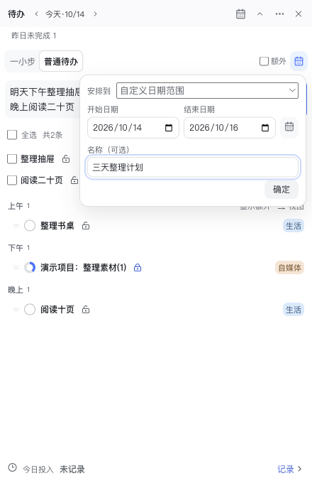
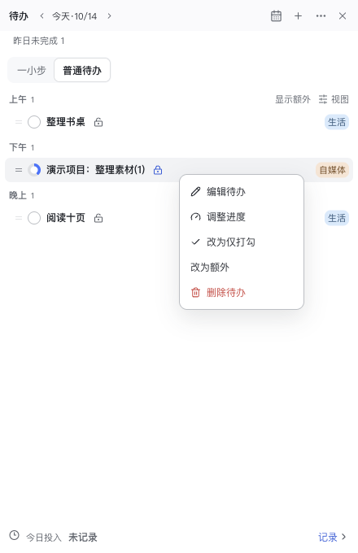
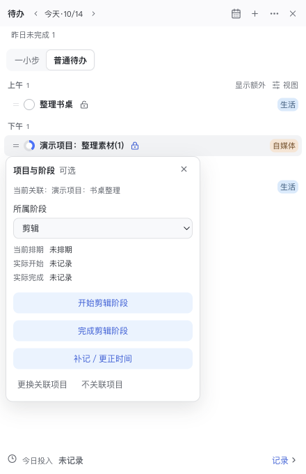
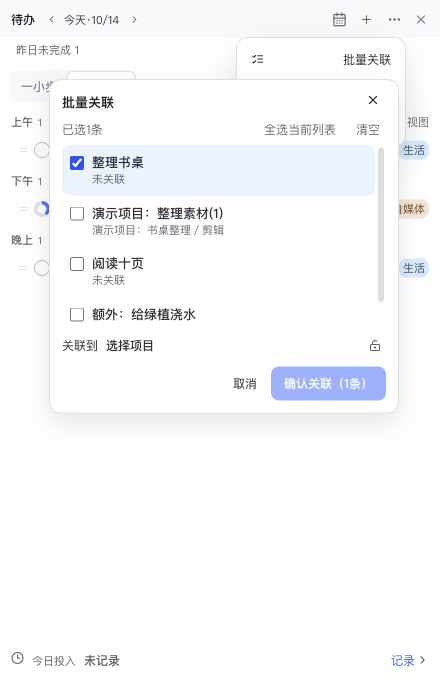

# 待办完整操作手册

适用于2026年10月14日分享的Mac源码版。图中所有项目、任务、日期和时长均为新建的虚构演示数据，不是作者的工作记录。

这套待办可以在首页、菜单栏面板和桌面置顶窗使用。它们共享同一份数据；完成、改标题、改进度或项目关联，会同步到其他窗口。窗口当前查看的日期可以不同。

## 目录

1. [入口、窗口和日期](#1-入口窗口和日期)
2. [一小步](#2-一小步)
3. [新建与批量输入](#3-新建与批量输入)
4. [日期范围](#4-日期范围)
5. [普通与额外待办](#5-普通与额外待办)
6. [完成、撤销与进度](#6-完成撤销与进度)
7. [修改、分类、排序和删除](#7-修改分类排序和删除)
8. [项目与阶段关联](#8-项目与阶段关联)
9. [昨天未完成复制到今天](#9-昨天未完成复制到今天)
10. [预计时长与实际投入](#10-预计时长与实际投入)
11. [行程、首页统计及复盘](#11-行程首页统计及复盘)
12. [键盘操作与完整交互索引](#12-键盘操作与完整交互索引)
13. [故障与数据安全](#13-故障与数据安全)

## 1 入口、窗口和日期

### 1.1三种入口

| 入口 | 打开方式 | 适合做什么 |
|---|---|---|
| 首页待办 | 打开主App进入首页 | 看待办与项目行动、按时间／分类查看，使用完整新建预览 |
| 菜单栏面板 | 点击macOS菜单栏的待办图标；悬停提示为“LY Creator OS·今日待办” | 随手查看、完成、新建、改进度和记录投入 |
| 桌面置顶窗 | 菜单栏待办右上角`…→浮在桌面` | 工作时持续保留清单 |

菜单栏还有独立的排期图标，不要把两个图标混淆。待办面板失去焦点时会隐藏，再点菜单栏图标即可回来；桌面窗用于持续显示。右上角`×`关闭当前待办窗，不是删除清单。`…→打开主窗口`返回主App。

伴随窗可以拖动顶部空白区域移动，也能拖边缘调整大小。最小宽度240px、最小高度220px；内容较多时滚动列表。关闭窗口不删除数据。

**图1：普通待办面板。** 顶部是日期、行程、新建、更多和关闭；中间是视图与任务；底部是当天实际投入。

**图2：首页待办。** 首页使用“按时间／按分类”切换，和伴随窗引用相同任务。

### 1.2查看任意一天

- 日期左右箭头分别查看前一天、后一天。
- 点击日期文字，打开日历直接选日；首页在非今天时提供`今天`按钮。
- 查看未来日期，可以提前建立那一天的计划。
- 查看日期不会自动修改任何待办日期，也不会自动生成副本。
- 有计划日期的待办只留在那个日期。昨天没做完，今天不会自动出现；今天回头勾选昨天的待办，它仍属于昨天。
- 无日期的手动待办，未完成时显示于今天；完成后按完成日保留。
- 日期范围待办按范围显示，规则见第4节。

## 2 一小步

一小步是每天单独保存的起步动作，不是普通清单中的一条待办，也不因完成它而批量完成其他任务。

1. 在伴随窗选择`一小步`。
2. 点击文字旁的铅笔，输入一个很小、能开始执行的动作，例如“把书放回书架”。
3. 点击`保存`。编辑时按Enter保存，Shift＋Enter换行，Esc取消。
4. 做到后点击`这一步做到了`，出现短暂完成反馈并进入普通待办。
5. 一小步完成后，顶部标签可能收起。需要回看时用`…→查看已完成的一小步`。
6. 点击`撤销完成`可以恢复未完成状态；`返回待办列表`回到普通清单。

可以直接点击`普通待办`，不必先完成一小步。不同日期的一小步相互独立，编辑上限300字。跨窗口同时修改时若提示冲突，先看最新内容再重试，不要反复提交旧稿。

## 3 新建与批量输入

### 3.1菜单栏和桌面窗

1. 点右上角`＋`，展开新建区并进入普通待办。
2. 一行输入一条；可以一次粘贴多行。逗号、分号、句号等分隔符也可能拆成多条，创建前务必检查预览。
3. 检查下方逐条预览，尤其是日期、项目和阶段推荐。
4. 点击`创建N条`，或者在输入框按Command＋Enter。
5. 成功后输入区、“额外”和日期入口自动收起，额外／日期范围选项重置；再次点`＋`开始下一批。

失败时输入和选项保留，界面显示错误。请纠正后重试；不要因为窗口仍开着就假定数据已经创建。

新建时，`额外`复选框与日期图标在“一小步／普通待办”右侧同行，不单独占一排；不新建时不显示。日期图标打开当前批次的安排方式，完整范围设置只在浮层里出现。一小步完成后即使标签已隐藏，新建选项仍可使用。

### 3.2首页完整预览

点首页`新建`打开对话框。多行解析后，可以逐条修改标题、日期、时段和分类，调整项目／阶段；`×`仅移除尚未创建的预览项。最后点击`创建N条待办`才写入正式清单。

创建前也支持选择多条预览统一绑定项目。已手动选择的项目／阶段优先于文字推测。想更改日历日期或每条分类时，首页完整预览比窄窗更方便。

### 3.3文字解析怎么理解

| 输入 | 结果或用法 |
|---|---|
| `整理书架` | 没有明确日期时使用当前查看日；没有时段则为未分时段 |
| `明天下午整理抽屉` | 明天相对于真实今天，不相对于你正在查看的日期；时段为下午 |
| `晚上阅读二十页` | 使用默认日期，识别晚上 |
| `整理素材(1.5)` | 标题末尾的括号数字可作为预计小时数，1.5表示1小时30分钟；不等于实际投入 |
| 项目名称＋具体动作 | 可能推荐对应项目／阶段，必须在预览中核对 |

文本中的百分比也可识别为进度；最终以创建预览为准。不要把自然语言解析当作任意日程指令理解器。复杂日期、模糊项目名、同名项目应手动检查。仅“写文案”“拍摄”这种通用动作，不应理解为你已经指定了某个项目。单批创建接口最多50条；批量关联和复制的上限另为100条。

`Command＋Shift＋Space`是全局快速记录快捷键，内容进入灵感采集，不是待办批量新建快捷键。

## 4 日期范围

日期范围适合“这几天都能做”的清单，不用人为拆成每天一份。

1. 新建时点右侧日期图标（首页直接在对话框内设置）。
2. `安排到`选择`自定义日期范围`。
3. 填写开始、结束日期；也可以点日历图标，在范围日历中选择。
4. 名称可选，如“三天整理计划”；不填则显示日期范围。
5. 确认日期设置，回到输入区，再点击创建。日期浮层的`确定`只是收起设置，不会创建待办。

- 起止日期都包含在范围内；同一天开始结束也有效。
- 结束不能早于开始，无效范围会阻止创建／保存。
- 选择范围后，整批采用该明确范围，文本中的单日／时段不再覆盖它。
- `安排到`也列出已有范围，按起止日期与名称去重；选中只是填入草稿，不会修改原范围内的其他待办。
- 范围内每天看到的是同一个ID。完成一次，其他日期看到的也为完成，不会每天重置。
- 范围分组显示名称、起止日期与已完成数量。
- 创建未来范围后，创建窗口跳到开始日；其他窗口不会被强行切日。
- 范围结束后不自动延期；回到原日期仍可查看。
- 修改已建范围：右键`编辑待办`；要转回单日，改为`单日／未指定日期`，填写日期与时段。
- 范围内拖动只调整顺序，不会因为拖入上午或下午就拆成单日任务。

## 5 普通与额外待办

普通清单代表主要安排；额外清单是另外分类显示的任务，不是另一套数据库。

- 新建时勾选`额外`，本批任务带额外标记。
- 普通待办视图中点`显示额外`／`不显示额外`控制展示；隐藏不删除、不重置进度。
- 普通任务全部完成时，额外任务会自动显示；仍可手动隐藏。
- 额外分组旁的`＋`可以直接新建额外待办。
- 已有任务右键`改为额外`／`改为普通待办`可以重新分类。
- 创建额外任务成功后会显示对应额外列表，方便检查；下一次创建不默认继续勾选额外。

## 6 完成、撤销与进度

### 6.1圆圈勾选

点左侧圆圈完成任务；完成后显示勾和完成样式。再点可重新打开。进度任务完成会变成100%，重新打开恢复完成前的进度，而不是简单丢回0%。

伴随窗完成操作后会出现最近一条操作的`撤销`；它只恢复对应操作，并有版本保护。别处已经修改的任务不应被旧撤销覆盖。删除待办没有同样的即时撤销按钮，见第7节。

### 6.2记录部分进度

1. 右键任务，选择`记录进度`（已有进度时叫`调整进度`）。
2. 拖动滑杆，或者点25%、50%、75%。
3. 滑杆按5%步进，最高95%；松开鼠标或键盘调整后保存。
4. 浮层内`完成`是结束进度编辑并保存当前值，**不是把任务标成100%**。真正完成任务请点击列表左侧圆圈。
5. 想取消百分比模式，用右键`改为仅打勾`，进度会归零。

部分进度会显示在圆环里。调整进度不自动填写实际工时，也不自动完成项目阶段。

## 7 修改、分类、排序和删除

### 7.1直接改标题

单击标题进入行内编辑；Enter或点击别处保存，Esc取消。标题不能空白，最长300字。中文输入法正在选字时，Enter先服务于输入法，不会误提交。保存失败会留下错误提示和草稿。

只改标题不会偷偷更改已保存的日期、项目或阶段；要改这些属性，使用对应入口。预计时长从最新标题读取，因此改末尾括号数字会影响预计摘要。

### 7.2右键菜单

| 选项 | 作用 | 注意 |
|---|---|---|
| 编辑待办 | 改标题、日期／范围、时段、分类、项目和阶段 | 保存后生效，取消不写入 |
| 复制到今天 | 将过去未完成的单日手动任务复制到今天 | 原件保留；非候选不会显示 |
| 记录／调整进度 | 切到百分比进度编辑 | 不代表实际工时 |
| 改为仅打勾 | 退出百分比模式 | 会清零进度 |
| 改为额外／普通待办 | 调整任务分组身份 | 不删除任务 |
| 删除待办 | 从活动清单移除 | 不提供面向用户的待办回收站；谨慎点击，重要内容先备份 |

### 7.3视图与分类

- 首页：`按时间`、`按分类`。
- 伴随窗：`视图→全部／按时间／按分类`。
- 按时间会分上午、下午、晚上、未分时段；完成项仍保留。
- 按分类查看分类分组；日期范围仍有自己的范围分组。
- 可点击行上的分类标记调整分类；右键编辑中也可修改。
- 首页分类标题支持右键选颜色。设置页的首页与待办区域可以调整分类名称、颜色和统计权重。

### 7.4排序与跨时段拖动

拖住任务左侧`＝`形把手调整顺序；拖动时看插入位置。把手获得键盘焦点后可按Option（Alt）＋↑／↓。

按时间模式下，普通单日任务可拖到另一时段，或者空时段的落点；这会改当前任务的时段，但不跨日期移动。其他视图按现有可见分组排序。日期范围不通过拖动改成单日。

排序不复制任务，不改变标题、进度和工时。并发改动或无效目标会拒绝保存，重新查看最新列表后再拖。

## 8 项目与阶段关联

### 8.1小锁图标不是隐私锁

标题旁空锁／锁形图标表示是否关联项目。它不是锁住任务，也不是收入隐私锁。

1. 点击图标，搜索项目名称或简称。
2. 选择目标项目；有多个可能时人工判断。
3. `所属阶段`可进一步指定大纲、文案、拍摄、剪辑等当前项目已启用阶段，也可不指定。
4. 关联后再次点击，可看当前关联、阶段预计安排、实际开始／完成。
5. 用`更换关联项目`改绑；`不关联项目`解绑。

默认优先活跃项目，需要时使用界面提供的已结束项目范围开关。回收站项目不可作为普通候选。创建前的预览关联尚未保存；已建任务中的选择会修改该任务，其他窗口同步。

### 8.2开始、完成和补记阶段

选定项目阶段后，可以点`开始某阶段`、`完成某阶段`、`补记／更正时间`；已经完成时可`重新打开某阶段`。

日期与上午／下午／晚上构成粗粒度时间点。操作中先检查日期／时段，再点确认；取消不保存。这里改的是项目阶段的实际时间，不是待办计划日期，也不是你当天填的投入小时数。

勾选一个有关联的待办后，App可能提示“开始某阶段？”：核对推荐阶段、开始日期和时段，再选`确认开始`。也可`暂不`，待办仍然完成，但不会因此替你写阶段时间。完成一条待办不等于自动完成整个项目阶段。

### 8.3批量关联

首页用批量关联入口；伴随窗从`…→批量关联待办`进入。

1. 勾选当前列表内要处理的待办，可`全选当前列表`、`清空`，最多100条。
2. 在`关联到`选择目标项目，或明确选`不关联项目`。
3. 默认同项目保留原阶段，换项目清除旧阶段；如要统一阶段，勾选`统一设置阶段`后再选。
4. 检查覆盖提醒和逐条关联预览。
5. 点`确认关联（N条）`或`确认取消关联`。

这只改选中的关联，不改日期、进度和工时。任何选中项已在其他窗口变化时，整批拒绝而不是只保存一部分；关闭后重新选择。

## 9 昨天未完成复制到今天

**这是复制，不是挪走。昨天的原记录会完整保留。**

1. 查看今天；有昨天未完成候选时，显示`昨日未完成N`。
2. 点开浮层，默认全部不选。
3. 逐条勾选，或全选；需要更早日期时点`选择日期`。
4. 检查条目后点`复制到今天（N）`。
5. 成功提示中可点`撤销`，仅移除本次尚未被修改的副本。

复制后的规则：

- 新条目是独立ID，计划日期为今天，时段为未分时段。
- 标题、进度、分类、项目／阶段和额外标记保留。
- 今天完成副本，不影响昨天原件；原件不会因复制而自动完成。
- 昨天未完成计数可能仍然存在，这是原件保留的结果，不是复制失败。
- 复制继承的进度不凭空算成今天新完成的进展，也不复制工时、排期或阶段时间。
- 只列过去未完成的单日手动待办；已完成、无日期、今天／未来、日期范围、排期生成事项不在候选中。
- 查看过去日期时，可对符合条件的单条右键`复制到今天`。
- 切来源日期、关闭浮层会清空勾选。取消不写入。
- 一次最多100条；选中项在其他窗口被修改／完成／移除时，整批拒绝。点击`重新选择`加载最新候选。
- 同一次提交的重试有重复保护，但重新打开浮层再次主动复制仍可生成新副本；请先查看今天清单，避免主动重复复制。
- 副本后来被编辑或完成，或者撤销栈已变化时，旧撤销会被拒绝，防止抹掉新工作。原件后来被修改不妨碍撤销尚未修改的副本。
- 撤销是临时操作保护，不是长期版本管理；重启后不保证仍可撤销。

## 10 预计时长与实际投入

### 10.1标题里的预计时长

`整理素材(2)`表示预计2小时，`阅读(0.5)`表示30分钟。只认标题末尾数字括号；没有填写就保持未填写，不会自动算作0小时。

项目阶段的预计摘要会汇总关联待办的总预计、已完成条目预计和填写覆盖。这个数字只是计划预算，不会自动加入实际工时。

### 10.2实际投入手动填写

1. 点击待办底部`记录`（紧凑入口可能显示铅笔）。
2. 输入当天总小时数，例如2.5。
3. 或点`按分类记录`，分别填写自媒体、AI、其他工作的小时数。
4. 点击`保存`。

- 数字允许小数，转换为分钟保存；请填0至24小时范围内的有效值。
- 保存的是当日总量，不是“再加这么久”。原来2小时，改成3小时，结果为3小时而非5小时。
- 按分类记录的合计替代总时长，不与总量重复累加。
- “未记录”和明确填写0小时含义不同。
- 日期左右箭头可以补记其他日；日期文字区域支持左右拖动、双指横滑和左右方向键，Shift＋滚轮也可横向换日。
- 不同日期的未保存草稿分开；切到另一日后点保存，只保存当前日，不是自动保存刚才看过的所有日期。
- 工时独立于待办勾选、复制和项目阶段时间，不会因为完成一条任务而自动算出耗时。

## 11 行程、首页统计及复盘

### 11.1出差、出游和休息

待办标题栏的行程日历图标与“新建中的日期图标”不是一回事：前者建立行程，后者设置新待办的日期范围。

点行程入口，选择出差／出游／休息，选起止日期；`更多设置`中可填名称或目的地、项目、备注，最后保存。已有行程可点状态摘要编辑；取消行程和提前结束需要确认。取消后行程记录仍保留，但待办区不再显示该行程状态。

行程会影响待办区相应状态展示和部分首页统计的休息口径，不会自动删任务、移动计划或填写工时。想为旅行期间建任务，用日期范围，而不是指望行程自动生成待办。

### 11.2首页成长与项目行动

首页成长／投入图表读取待办与每日投入。普通单日手动待办参与每日完成度；额外与日期范围任务不混入该日常完成度。预计时长、实际投入、任务完成率是不同口径；分类权重可在设置调整，不应把它们相加当作准确工作小时数。

首页还可能显示项目拍摄清单等项目行动。它们引用项目内容，点击标题可进入对应项目，完成也作用于原项目条目；不能把这些条目当作所有手动待办操作都可用的普通任务。

首页的成长植物随待办完成度变化；点击植物、点击浇水壶只有互动动画，不会凭空增加进度。点击旁边书本可选择雨声、火炉、溪流白噪音，调节音量或停止；关闭书本面板不等于停止声音。天气城市在设置中配置，天气背景不是任务提醒。

`计划与复盘`用于周期目标、自由复盘、生活记录和经验记录，不是再创建一套待办。自由复盘样式栏默认收起，可手动展开，编辑快捷键仍可用；本版没有把经验和自由复盘自动合并为一个业务对象。

## 12 键盘操作与完整交互索引

| 场景 | 操作 |
|---|---|
| 伴随窗批量输入 | Command＋Enter创建；Windows式键位环境也兼容Ctrl＋Enter |
| 一小步编辑 | Enter保存、Shift＋Enter换行、Esc取消 |
| 行内待办标题 | Enter／失焦保存、Esc取消 |
| 排序把手聚焦 | Option（Alt）＋↑／↓ |
| 日期投入文字区聚焦 | ←／→切日，鼠标左右拖动／触控板横滑也可 |
| 下拉菜单 | Enter打开，方向键切换，Enter确认，Esc关闭 |
| 多层浮层 | Esc先关闭最上层；点击外部关闭相应浮层 |
| 全局快速记录 | Command＋Shift＋Space；它不是待办新建 |

| 位置 | 可操作内容 | 对应章节 |
|---|---|---|
| 顶部日期 | 前后一天、日历选日、首页返回今天 | 1 |
| 一小步标签／铅笔 | 编辑、保存、取消、完成、撤销、更多中回看 | 2 |
| 新建入口 | 展开／收起、多行解析、预览、移除草稿、逐条修改、批量关联、创建 | 3 |
| 新建右侧 | 额外标记、日期安排、已有范围、范围日历、可选名称 | 4、5 |
| 列表圆圈 | 完成、重新打开、部分进度显示、最近完成撤销 | 6 |
| 标题与右键 | 行内编辑、完整编辑、进度、切换模式、额外身份、复制、删除 | 6、7、9 |
| 视图与分类 | 全部／时间／分类、分类调整、首页分类颜色、隐藏额外 | 5、7 |
| 拖动把手 | 组内排序、按时间跨时段移动、键盘排序 | 7 |
| 项目小锁 | 搜索、选择、解绑、换项目、阶段选择、实际时间操作 | 8 |
| 更多菜单 | 批量关联、已完成一小步、浮在桌面、主窗口 | 1、2、8 |
| 昨日未完成 | 默认不选、切来源日期、全选／清空、复制、重载、撤销 | 9 |
| 底部投入 | 总量／分类、补记日期、保存、读取失败重试 | 10 |
| 行程图标／摘要 | 新建、日期、更多字段、编辑、取消、提前结束 | 11 |
| 窗口边缘与关闭 | 缩放、移动、隐藏／关闭；不删除数据 | 1 |

## 13 故障与数据安全

**菜单栏图标不见了：** 先确认App还在运行，确认没把排期图标当成待办；看看菜单栏空间和系统／第三方隐藏设置。打开`/Applications/LY Creator OS.app`，设置里检查当前版本和“Applications安装版”。只运行了旧副本时，关掉旧副本再打开正式安装版。

**完成后在今天找不到：** 看任务的原计划日期或日期范围。今天补勾昨天任务，不会自动迁入今天。额外任务还要检查是否被隐藏。

**复制按钮不出现：** 必须是过去的单日、未完成、手动任务。今天的入口还要求昨天有候选；没有时可回到过去日期对符合条件的任务右键操作。

**关联被拒绝或提示已变化：** 另一窗口可能已修改数据。重新打开选择器核对最新状态，不要用旧草稿覆盖。

**创建后面板不消失：** 检查是否有保存错误、空标题或无效日期。只有创建成功才会收起。

**误删或大量误改：** 先停止继续编辑，检查设置中的备份／恢复点。恢复影响整个工作区，不是只恢复一条待办。恢复前先备份当前内容。

**给朋友演示：** 新建隔离数据，不发自己App用户目录。截图也可能包含标题、客户、金额、账号和附件路径；本仓库说明图均在空白隔离数据库中重新生成。
